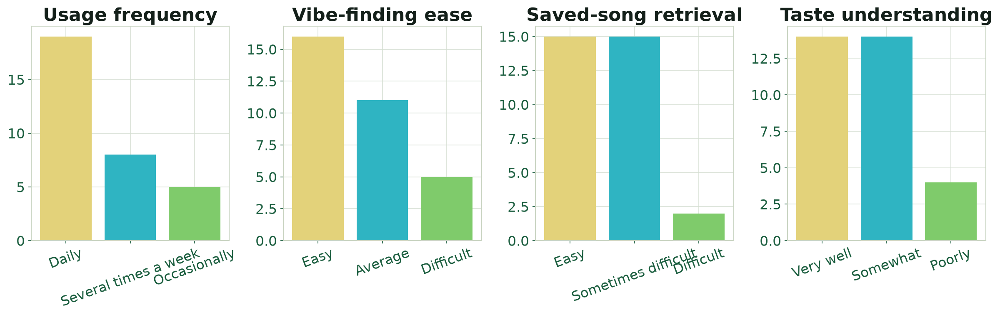
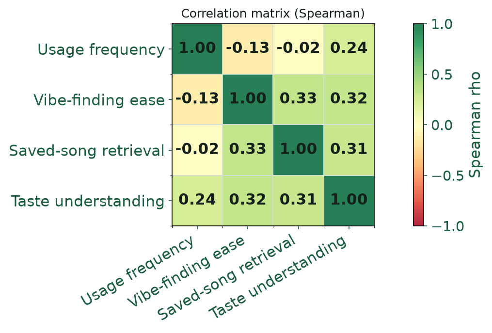

# Statistical Analysis — Reimagining the Personal Music Experience

**Source:** `Music Streaming Platform Experience (Responses) - Form responses 1.csv`  
**Responses:** 32  
**Generated by:** `webapp/analysis/analysis.py` (re-run after any CSV update)

## 1. Data cleaning and quality

- 32 responses received; all rows retained in the descriptive analysis.
- Numeric ages: n=32, mean=19.69, median=19, SD=2.19, range=18-30.
- Ordinal coding: Easy / Very well / Daily = 3; Average / Somewhat / Several times a week = 2; Difficult / Poorly / Occasionally / Sometimes difficult = 1.
- Neutral comparison value = 2 (the middle category).

**Flagged low-quality / duplicate responses (declared, not silently removed):**

- row 2 (R01): all open answers non-substantive
- row 9 (R08): non-serious open answers
- Possible duplicate: 2 rows share a name
- Possible duplicate: 2 rows share a name

## 2. Descriptive statistics

### Primary platform

| Response | Count | % |
|---|---:|---:|
| Spotify | 23 | 71.9 |
| YouTube Music | 4 | 12.5 |
| Other | 3 | 9.4 |
| Apple Music | 2 | 6.2 |

### Usage frequency

| Response | Count | % |
|---|---:|---:|
| Daily | 19 | 59.4 |
| Several times a week | 8 | 25.0 |
| Occasionally | 5 | 15.6 |

### Discovery source

| Response | Count | % |
|---|---:|---:|
| Outside the app | 9 | 28.1 |
| Search | 9 | 28.1 |
| Recommendations | 8 | 25.0 |
| Playlist | 6 | 18.8 |

### Vibe-finding ease

| Response | Count | % |
|---|---:|---:|
| Easy | 16 | 50.0 |
| Average | 11 | 34.4 |
| Difficult | 5 | 15.6 |

### Action after liking a song

| Response | Count | % |
|---|---:|---:|
| Add it to a playlist | 17 | 53.1 |
| Save/Like it | 10 | 31.2 |
| Just listen and move on | 5 | 15.6 |

### Saved-song retrieval

| Response | Count | % |
|---|---:|---:|
| Easy | 15 | 46.9 |
| Sometimes difficult | 15 | 46.9 |
| Difficult | 2 | 6.2 |

### Taste understanding

| Response | Count | % |
|---|---:|---:|
| Very well | 14 | 43.8 |
| Somewhat | 14 | 43.8 |
| Poorly | 4 | 12.5 |

## 3. Ordinal measures, t-tests and 95% confidence intervals

H0: mean = 2 (neutral). H1: mean differs from 2. Two-tailed, alpha = 0.05.

| Measure | n | Mean | SD | t | df | p | 95% CI |
|---|---:|---:|---:|---:|---:|---:|---|
| Usage frequency | 32 | 2.44 | 0.76 | 3.259 | 31 | 0.0027 | [2.16, 2.71] |
| Vibe-finding ease | 32 | 2.34 | 0.75 | 2.609 | 31 | 0.0138 | [2.08, 2.61] |
| Saved-song retrieval | 32 | 1.94 | 1.01 | -0.349 | 31 | 0.7297 | [1.57, 2.30] |
| Taste understanding | 32 | 2.31 | 0.69 | 2.552 | 31 | 0.0159 | [2.06, 2.56] |

**Interpretation:** positive t-values indicate responses above the neutral midpoint. Where p < 0.05 the mean is significantly above neutral; where p >= 0.05 there is no significant difference. Report this honestly — a good-but-not-great baseline is still a valid finding.

## 4. Correlations (Pearson and Spearman)

| Pair | n | Pearson r | p | Spearman rho | p |
|---|---:|---:|---:|---:|---:|
| Usage frequency vs Vibe-finding ease | 32 | -0.103 | 0.5737 | -0.132 | 0.4706 |
| Usage frequency vs Saved-song retrieval | 32 | -0.047 | 0.7978 | -0.023 | 0.8999 |
| Usage frequency vs Taste understanding | 32 | +0.222 | 0.2214 | +0.240 | 0.1854 |
| Vibe-finding ease vs Saved-song retrieval | 32 | +0.328 | 0.0667 | +0.331 | 0.0642 |
| Vibe-finding ease vs Taste understanding | 32 | +0.410 | 0.0198 | +0.325 | 0.0700 |
| Saved-song retrieval vs Taste understanding | 32 | +0.304 | 0.0904 | +0.312 | 0.0817 |

Critical |r| at n≈32, alpha=0.05 (two-tailed) ≈ 0.349. Associations below this are weak and statistically non-significant — describe them as directional only.

## 5. Open-text themes

| Theme | Respondents | % |
|---|---:|---:|
| Ads / paywall | 17 | 53.1 |
| Recommendations / taste | 12 | 37.5 |
| UI / customisation | 6 | 18.8 |
| Vibe / mood | 4 | 12.5 |
| Saving / organising | 2 | 6.2 |

## 6. Charts

---

*Regenerate with:* `python3 webapp/analysis/analysis.py --csv <updated.csv>`
