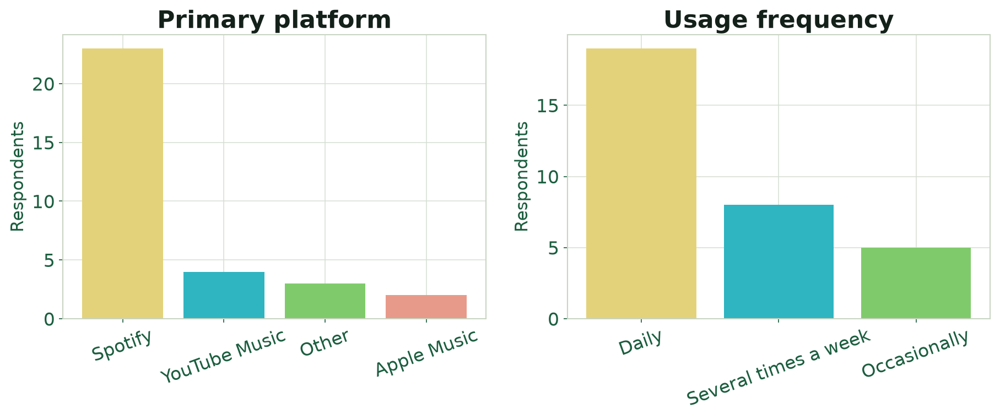
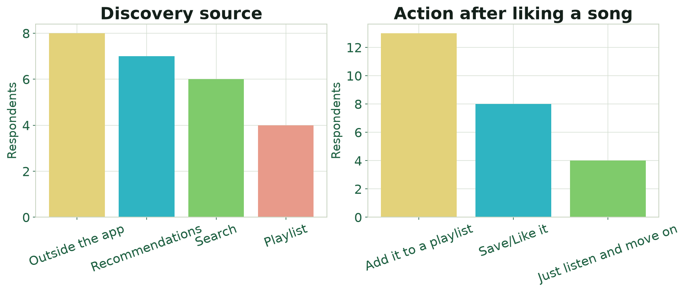
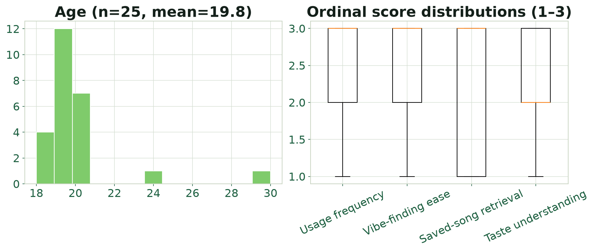

# Statistical Analysis — Reimagining the Personal Music Experience

**Source:** `Music Streaming Platform Experience (Responses) - Form responses 1.csv`  
**Responses:** 29  
**Generated by:** `webapp/analysis/analysis.py` (re-run after any CSV update)

## 1. Data cleaning and quality

- 29 responses received; all rows retained in the descriptive analysis.
- Numeric ages: n=29, mean=19.79, median=19, SD=2.27, range=18-30.
- Ordinal coding: Easy / Very well / Daily = 3; Average / Somewhat / Several times a week = 2; Difficult / Poorly / Occasionally / Sometimes difficult = 1.
- Neutral comparison value = 2 (the middle category).

**Flagged low-quality / duplicate responses (declared, not silently removed):**

- row 2 (R01): all open answers non-substantive
- row 9 (R08): non-serious open answers
- Possible duplicate: 2 rows share a name
- Possible duplicate: 2 rows share a name

## 2. Descriptive statistics

### Primary platform

| Response | Count | % |
|---|---:|---:|
| Spotify | 20 | 69.0 |
| YouTube Music | 4 | 13.8 |
| Other | 3 | 10.3 |
| Apple Music | 2 | 6.9 |

### Usage frequency

| Response | Count | % |
|---|---:|---:|
| Daily | 18 | 62.1 |
| Several times a week | 7 | 24.1 |
| Occasionally | 4 | 13.8 |

### Discovery source

| Response | Count | % |
|---|---:|---:|
| Outside the app | 9 | 31.0 |
| Recommendations | 8 | 27.6 |
| Search | 7 | 24.1 |
| Playlist | 5 | 17.2 |

### Vibe-finding ease

| Response | Count | % |
|---|---:|---:|
| Easy | 15 | 51.7 |
| Average | 10 | 34.5 |
| Difficult | 4 | 13.8 |

### Action after liking a song

| Response | Count | % |
|---|---:|---:|
| Add it to a playlist | 16 | 55.2 |
| Save/Like it | 9 | 31.0 |
| Just listen and move on | 4 | 13.8 |

### Saved-song retrieval

| Response | Count | % |
|---|---:|---:|
| Easy | 15 | 51.7 |
| Sometimes difficult | 13 | 44.8 |
| Difficult | 1 | 3.4 |

### Taste understanding

| Response | Count | % |
|---|---:|---:|
| Very well | 14 | 48.3 |
| Somewhat | 12 | 41.4 |
| Poorly | 3 | 10.3 |

## 3. Ordinal measures, t-tests and 95% confidence intervals

H0: mean = 2 (neutral). H1: mean differs from 2. Two-tailed, alpha = 0.05.

| Measure | n | Mean | SD | t | df | p | 95% CI |
|---|---:|---:|---:|---:|---:|---:|---|
| Usage frequency | 29 | 2.48 | 0.74 | 3.524 | 28 | 0.0015 | [2.20, 2.76] |
| Vibe-finding ease | 29 | 2.38 | 0.73 | 2.807 | 28 | 0.0090 | [2.10, 2.66] |
| Saved-song retrieval | 29 | 2.03 | 1.02 | 0.183 | 28 | 0.8564 | [1.65, 2.42] |
| Taste understanding | 29 | 2.38 | 0.68 | 3.018 | 28 | 0.0054 | [2.12, 2.64] |

**Interpretation:** positive t-values indicate responses above the neutral midpoint. Where p < 0.05 the mean is significantly above neutral; where p >= 0.05 there is no significant difference. Report this honestly — a good-but-not-great baseline is still a valid finding.

## 4. Correlations (Pearson and Spearman)

| Pair | n | Pearson r | p | Spearman rho | p |
|---|---:|---:|---:|---:|---:|
| Usage frequency vs Vibe-finding ease | 29 | -0.220 | 0.2510 | -0.200 | 0.2992 |
| Usage frequency vs Saved-song retrieval | 29 | -0.118 | 0.5415 | -0.086 | 0.6574 |
| Usage frequency vs Taste understanding | 29 | +0.121 | 0.5324 | +0.172 | 0.3733 |
| Vibe-finding ease vs Saved-song retrieval | 29 | +0.319 | 0.0912 | +0.324 | 0.0869 |
| Vibe-finding ease vs Taste understanding | 29 | +0.350 | 0.0627 | +0.263 | 0.1679 |
| Saved-song retrieval vs Taste understanding | 29 | +0.240 | 0.2104 | +0.246 | 0.1975 |

Critical |r| at n≈29, alpha=0.05 (two-tailed) ≈ 0.367. Associations below this are weak and statistically non-significant — describe them as directional only.

## 5. Open-text themes

| Theme | Respondents | % |
|---|---:|---:|
| Ads / paywall | 15 | 51.7 |
| Recommendations / taste | 11 | 37.9 |
| UI / customisation | 6 | 20.7 |
| Vibe / mood | 3 | 10.3 |
| Saving / organising | 1 | 3.4 |

## 6. Charts

---

*Regenerate with:* `python3 webapp/analysis/analysis.py --csv <updated.csv>`
